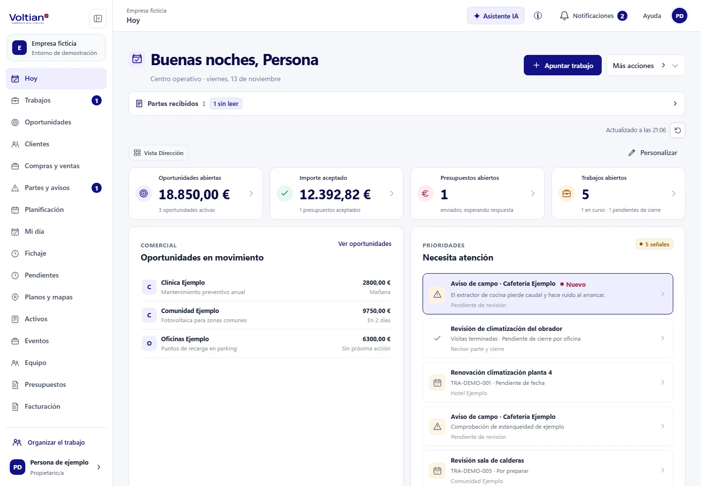

# Voltian OS · Eduardo Arjona

Imagina que una empresa de climatización recibe un aviso en un local que ya conoce. En oficina preparan el presupuesto y asignan la visita. El técnico mira la cita desde el móvil y al terminar deja el parte, las fotos y la conformidad. Cuando el cliente vuelve a llamar, el equipo puede consultar qué se acordó y qué se hizo.

Creé Voltian OS desde cero para que ese recorrido se pueda llevar desde un mismo sitio. Definí el producto, diseñé los recorridos, desarrollé la aplicación y la puse en marcha para autónomos y empresas de instalación y mantenimiento.

[Ver el proyecto](https://eduardoarjonam.github.io/portfolio/) · [Probar la demo](https://eduardoarjonam.github.io/portfolio/casos/voltian/demo/)

## Qué puedes ver

- **Hoy** reúne los avisos, las prioridades y la actividad de la jornada. [PC](casos/voltian/imagenes/inicio-pc.webp) · [Móvil](casos/voltian/imagenes/inicio-movil.webp)
- **Presupuestos** permite preparar propuestas por partidas y seguir en qué estado están. [Ver la pantalla](casos/voltian/imagenes/presupuestos-pc.webp)
- **Agenda** muestra las visitas previstas, quién va y dónde hay solapes. [Ver la pantalla](casos/voltian/imagenes/agenda-pc.webp)
- **Mi día** reúne la ubicación, el acceso a planos y las comprobaciones de la intervención. [Ver la pantalla en móvil](casos/voltian/imagenes/mi-dia-movil.webp)

La aplicación reúne clientes y oportunidades, trabajos de campo, planos, activos, mantenimiento y documentación para gestoría. Las capturas muestran la interfaz de Voltian OS con un negocio de ejemplo. En la demo puedes recorrer Inicio, Clientes, Presupuestos y Trabajos, consultar un parte y simular su cierre con datos ficticios. [Abrir la demo](https://eduardoarjonam.github.io/portfolio/casos/voltian/demo/)

## Ejemplos de código

Desarrollé Voltian con React y TypeScript, una API en Fastify y PostgreSQL. Estos ejemplos se pueden leer por separado. [Código de la demo](casos/voltian/demo/)

- Detectar cuándo dos visitas del mismo equipo coinciden. [Solapes de agenda](casos/voltian/ejemplos/agenda.mjs)
- Ajustar un listado al espacio que tiene disponible. [Listado adaptable](casos/voltian/ejemplos/listado-adaptable.css)
- Dar a cada estado un marco y un fondo que se reconozcan de un vistazo. [Marcos por estado](casos/voltian/ejemplos/marcos-estado.html)

Para probar la demo en local, abre `casos/voltian/demo/index.html` en el navegador.
