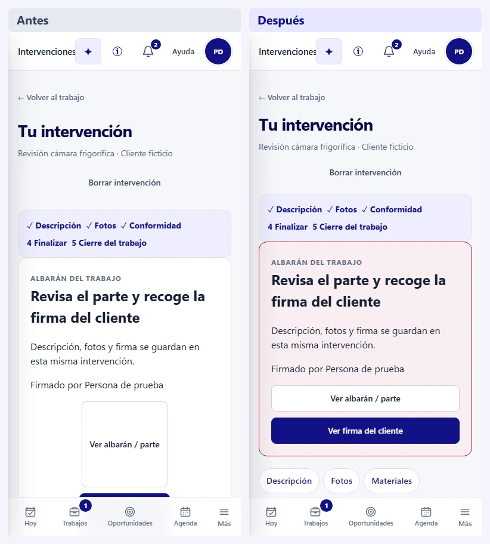

# Eduardo Arjona · Portfolio

Casos de diseño e implementación de producto.

## Voltian OS

Voltian OS ayuda a instaladoras y equipos de mantenimiento a organizar el trabajo. En este caso revisé el recorrido de Trabajos para dar más aire a los controles, distinguir los estados de un vistazo y acercar las acciones de albarán, firma y cierre en móvil.

[Ver el caso](https://eduardoarjonam.github.io/portfolio/) · [Probar la demo de Voltian](https://eduardoarjonam.github.io/portfolio/casos/voltian/demo/)

### Antes y después

Las imágenes comparan la pantalla de intervención antes y después de la revisión. Se reprodujeron las dos versiones de la interfaz con datos ficticios. En móvil se aprecia el cambio de altura y posición de los botones. En PC se ve cómo el marco y el fondo agrupan el parte y sus acciones.

| PC | Móvil |
| --- | --- |
| [Abrir comparación en PC](casos/voltian/imagenes/antes-despues-pc.webp) | [Abrir comparación en móvil](casos/voltian/imagenes/antes-despues-movil.webp) |

### Demo y ejemplos de código

La demo permite filtrar trabajos, abrir una ficha, consultar el parte y simular el cierre. Funciona con datos en memoria y se puede reiniciar.

- [Demo interactiva · código](casos/voltian/demo/)
- [Marcos y fondos por estado · HTML y CSS](casos/voltian/ejemplos/marcos-estado.html)
- [Diseño que responde al espacio disponible · CSS](casos/voltian/ejemplos/listado-adaptable.css)

Para ver la demo en local, abre `casos/voltian/demo/index.html` en el navegador.
